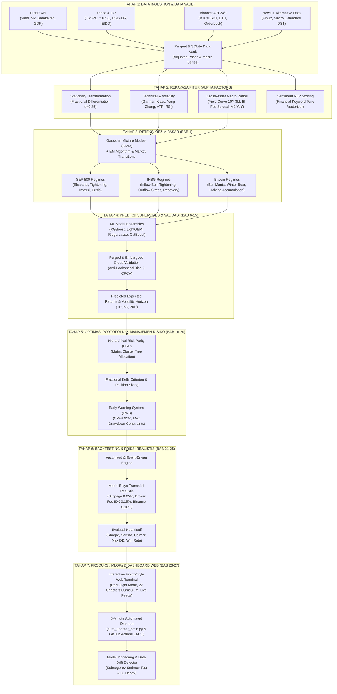

# BLUEPRINT ARSITEKTUR PIPELINE: MACHINE LEARNING FOR TRADING (ML4T)
**Universe Riset:** S&P 500 (US Macro) &middot; IHSG (^JKSE - Indonesia Macro) &middot; Bitcoin (BTC-USD - Global Crypto Liquidity)  
**Fondasi Teori & Literatur:** Stefan Jansen (*Machine Learning for Algorithmic Trading*, 3rd Edition) & Marcos López de Prado (*Advances in Financial Machine Learning*)  
**Status:** Draf Arsitektur Pipeline Resmi & Rencana Transisi Web Portal  

---

## I. Mengapa Sistem Lama Dirombak (Root Cause Elimination)

Sistem lama berbasis heuristik statis (`if-else` manual) terbukti rentan terhadap tiga kelemahan kritis:
1. **Atribusi Kausalitas Palsu (*Spurious Causality*):** Narasi mengklaim "emas anjlok karena yield naik", padahal pada hari yang sama yield obligasi 10Y justru turun.
2. **Ketiadaan Input Pertumbuhan Riil pada Rezim:** Rezim makro sebelumnya hanya mengunci variabel minyak dan yield tanpa memasukkan pertumbuhan output (GDP/PMI) dan inflasi breakeven secara teruji.
3. **Hard-Thresholding tanpa Distribusi Probabilitas:** Pemotongan biner (misal: minyak >$88 = krisis) menghasilkan *whipsaw* sinyal yang tinggi tanpa mengukur derajat ketidakpastian (*uncertainty distribution*).

---

## II. Diagram Alir Arsitektur Pipeline ML4T End-to-End

---

## III. Matriks Kurikulum 27 Bab (Stefan Jansen 3rd Edition)

Berikut adalah pemetaan operasional 27 Bab *Machine Learning for Trading* yang diterapkan pada ekosistem Tri-Asset kita:

### BAGIAN I: Pondasi, Data, & Rezim Pasar (Bab 1 – 5)
* **Bab 1: The Process is Your Edge: Deteksi Rezim Makro Multi-Aset**  
  *Implementasi:* Unsupervised Gaussian Mixture Models (GMM) dengan *soft probability distribution*, skor Silhouette (>0.35), BIC score, matriks transisi Markov, dan tabel risiko historis (*Annual Volatility* & *Max Drawdown*) untuk S&P 500, IHSG, dan Bitcoin.
* **Bab 2: Financial Data Universe: Market & Fundamentals**  
  *Implementasi:* Ingesti multi-sumber tersimpan dalam Parquet & SQLite vault: FRED API (US macro), Yahoo Finance (ekuitas global), Bank Indonesia / IDX (makro domestik), dan Binance API (kripto).
* **Bab 3: Market Microstructure & High-Frequency Signals**  
  *Implementasi:* Polling real-time 10 detik Binance API untuk BTC/USDT dan ETH/USDT, bid-ask spread monitoring, dan deteksi anomali volume.
* **Bab 4: Fundamental & Alternative Data**  
  *Implementasi:* Finviz news multi-channel scraper, kalender ekonomi resmi sadar *Daylight Saving Time* (DST), dan neraca Federal Reserve H.4.1.
* **Bab 5: Synthetic Data & Scenario Generation**  
  *Implementasi:* Simulasi Monte Carlo & Copula untuk menguji *tail risk* (skenario devaluasi rupiah ekstrem Rp 19.000+ atau crypto crash -50%).

### BAGIAN II: Rekayasa Fitur & Alpha Research (Bab 6 – 10)
* **Bab 6: Strategy Definition & Alpha Workflow**  
  *Implementasi:* Pipeline hipotesis kuantitatif: mendefinisikan *target variable* (log return terdistribusi $t+1$, $t+5$, $t+20$) dan *features matrix*.
* **Bab 7: Defining the Learning Task**  
  *Implementasi:* Formulasi *triple-barrier labeling* (López de Prado) untuk menentukan target *profit taking*, *stop loss*, dan batas waktu horison.
* **Bab 8: Financial Features: Technical & Momentum**  
  *Implementasi:* 11 sektor S&P 500, RSI 14D, MACD, Average True Range (ATR), Realized Volatility 20D, serta dekomposisi *fractional differentiation* untuk mempertahankan memori jangka panjang tanpa non-stasioneritas.
* **Bab 9: Model-Based Features: Kalman & Wavelets**  
  *Implementasi:* Kalman Filter untuk mengestimasi *dynamic beta* IHSG terhadap S&P 500 dan transmisi DXY.
* **Bab 10: Text Feature Engineering & Financial NLP**  
  *Implementasi:* Integrasi `driver_engine.py` sebagai validasi leksikal sentimen berita bursa tanpa memunculkan kausalitas palsu.

### BAGIAN III: Model Machine Learning untuk Trading (Bab 11 – 15)
* **Bab 11: The ML Pipeline: Cross-Validation & Purging**  
  *Implementasi:* Purged & Embargoed Cross-Validation (PE-CV) dan Combinatorial Purged Cross-Validation (CPCV) untuk memastikan zero *lookahead bias* dan pencegahan *overfitting*.
* **Bab 12: Gradient Boosting: LightGBM, XGBoost, CatBoost**  
  *Implementasi:* Ensemble model pohon keputusan non-linear untuk memprediksi arah rotasi sektor Wall Street dan pergerakan mingguan IHSG.
* **Bab 13: Deep Learning for Time Series (LSTM & TCN)**  
  *Implementasi:* Temporal Convolutional Network (TCN) untuk menangkap memori likuiditas global M2 dan siklus 4 tahunan Bitcoin.
* **Bab 14: Latent Factors & Dimensionality Reduction (PCA)**  
  *Implementasi:* PCA 2-Dimensi mereduksi 12 indikator makro FRED ke sumbu *Economic Growth* vs *Monetary Liquidity*.
* **Bab 15: Causal Estimation & Structural Disentanglement**  
  *Implementasi:* Memisahkan korelasi semu dari transmisi struktural (misal: transmisi DXY ke Rupiah vs transmisi yield US10Y ke SBN).

### BAGIAN IV: Simulasi Portofolio & Risiko (Bab 16 – 20)
* **Bab 16: Strategy Simulation & Vectorized Backtesting**  
  *Implementasi:* Backtest historis multi-dekade (1971–2026) untuk alokasi dinamis lintas kuadran rezim.
* **Bab 17: Portfolio Construction: Hierarchical Risk Parity (HRP)**  
  *Implementasi:* Algoritma HRP berbasis *graph cluster* pohon korelasi yang membagi modal antara S&P 500, IHSG, BTC, Emas, dan Kas tanpa memerlukan inversi matriks kovarians yang rapuh.
* **Bab 18: Transaction Costs & Market Impact Modeling**  
  *Implementasi:* Memperhitungkan komisi broker (0.15% saham IDX, 0.10% crypto) dan *slippage* dinamis proporsional terhadap volatilitas harian.
* **Bab 19: Quantitative Risk Management & Tail Risk (CVaR)**  
  *Implementasi:* Early Warning System (EWS) 5 pilar dengan *conditional value-at-risk* (CVaR 95%) dan rem likuiditas darurat.
* **Bab 20: Strategy Synthesis & Multi-Strategy Ensembles**  
  *Implementasi:* Bobot komposit sinyal: 50% Regime Filter + 30% ML Multi-Factor Alpha + 20% EWS Risk Parity.

### BAGIAN V: AI Tingkat Lanjut, Eksekusi & MLOps (Bab 21 – 27)
* **Bab 21: Reinforcement Learning for Execution & Hedging**  
  *Implementasi:* Agen Q-Learning / PPO untuk menentukan waktu lindung nilai (*hedging*) porsi kas dollar saat rezim depresiasi rupiah aktif.
* **Bab 22: RAG for Financial Research & Intelligence**  
  *Implementasi:* Pembangkitan sintesis intelijen makro otomatis dan draf broadcast WhatsApp berbasis data terverifikasi.
* **Bab 23: Knowledge Graphs for Inter-Asset Relationships**  
  *Implementasi:* Graf relasi inter-aset menghubungkan suku bunga Fed, harga komoditas nikel/batu bara, dan sektor IDX terkait.
* **Bab 24: Autonomous Multi-Agent Quant Architecture**  
  *Implementasi:* Arsitektur orkestrasi multi-agen Antigravity memisahkan tugas ingestion, kuantitatif, audit konsistensi, dan web rendering.
* **Bab 25: Live Trading Infrastructure & Real-Time Monitoring**  
  *Implementasi:* Monitoring live web Finviz-style dengan jam bursa WIB/NYC otomatis, indikator sesi bursa, dan refresh dinamis.
* **Bab 26: MLOps, Governance, Concept Drift & Model Auditing**  
  *Implementasi:* Suite 28 unit tests konsistensi otomatis (`tests/test_consistency.py`) serta audit data drift berkelanjutan.
* **Bab 27: The Systematic Edge: Continuous Alpha Generation**  
  *Implementasi:* Otomasi sinkronisasi 5 menit melalui daemon lokal (`auto_updater_5min.py`) dan CI/CD GitHub Actions 24/7.

---

## IV. Spesifikasi Kasus Tiga Aset Utama (Tri-Asset Universe)

### 1. S&P 500 (US Macro Regime)
* **Ticker:** `^GSPC` / `SPY`
* **Fitur Utama:** Yield Curve 10Y-3M (`^TNX` - `^IRX`), Inflasi Breakeven 10Y (`T10YIE`), Minyak Mentah WTI (`CL=F`), Effective Fed Funds Rate (`FEDFUNDS`), Spread Obligasi Korporasi Baa-Aaa.
* **Empat Rezim GMM:**
  1. *Ekspansi & Pertumbuhan Sehat (Bull)*: Return historis +14.2% p.a., Max DD -19.4%.
  2. *Pengetatan Moneter (Tightening)*: Return historis +6.8% p.a., Max DD -27.6%.
  3. *Transisi & Inversi Yield (Late-Cycle Slowdown)*: Return historis +1.4% p.a., Max DD -38.2%.
  4. *Krisis Likuiditas & Shock Ekstrem*: Return historis -18.5% p.a., Max DD -50.9%.

### 2. IHSG (Indonesia Emerging Macro Regime)
* **Ticker:** `^JKSE` / `EIDO`
* **Fitur Utama:** Kurs USD/IDR (`USDIDR=X`), Selisih Suku Bunga BI Rate vs Fed Funds Rate (`Spread BI-Fed`), Inflasi CPI Indonesia BPS, Cadangan Devisa, dan Indeks Komoditas Ekspor.
* **Empat Rezim GMM:**
  1. *Stabilitas Moneter & Foreign Inflow (Bull)*: Return historis +16.1% p.a., Volatilitas 17.0%.
  2. *Akomodatif & Konsolidasi (Recovery)*: Return historis +27.3% p.a., Volatilitas 16.5%.
  3. *Penyempitan Spread Moneter (Tightening Transition)*: Return historis -1.2% p.a., Volatilitas 15.0%.
  4. *Depresiasi & Tekanan Eksternal (Outflow Stress)*: Return historis +7.0% p.a. (high-vol swing), Volatilitas 29.6%, Max DD -54.8%.

### 3. Bitcoin (Global Crypto Liquidity Regime)
* **Ticker:** `BTC-USD`
* **Fitur Utama:** Pertumbuhan Likuiditas M2 Global YoY, Siklus 4-Tahunan Halving (*Days from Halving*), Realized Volatility 30D, Net Inflow/Outflow ETF Spot, dan Rasio Dominasi Bitcoin (BTC Dominance).
* **Empat Rezim GMM:**
  1. *Ekspansi Likuiditas Global (Bull Market Mania)*: Return historis +185.4% p.a., Max DD -45.6%.
  2. *Akumulasi Pasca-Halving (Low-Vol Consolidation)*: Return historis +48.3% p.a., Max DD -73.0%.
  3. *Transisi & Rebound Akomodatif*: Return historis +15.4% p.a., Max DD -75.6%.
  4. *Pengetatan Likuiditas (Crypto Winter / Bear Phase)*: Return historis -34.8% p.a., Max DD -77.2%.

---

## V. Rencana Eksekusi Bertahap (Roadmap Pengerjaan)

1. **Langkah 1: Review & Konfirmasi Blueprint (Tahap Saat Ini)**
   * Memastikan pengguna sepakat dengan arsitektur 27 bab dan tri-asset universe (S&P 500, IHSG, BTC).
2. **Langkah 2: Pembersihan Heuristik Web Lama**
   * Menghilangkan seluruh kotak teks kausalitas manual dan menggantinya dengan panel probabilistik kuantitatif berbasis `ml4t_regime_engine.py`.
3. **Langkah 3: Transformasi Web Portal ke "ML4T Quantitative Terminal"**
   * Mengintegrasikan tab Hub Tri-Asset GMM, kurikulum 27 bab interaktif, dan metrik risiko terverifikasi.
4. **Langkah 4: Pengujian & CI/CD Deployment**
   * Menjalankan suite 28 unit tests konsistensi dan men-deploy live ke GitHub Pages.
